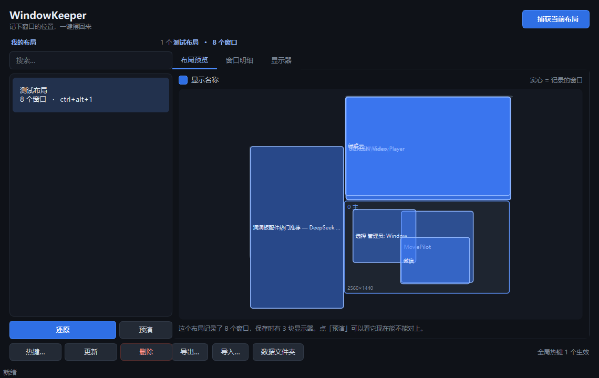

# WindowKeeper

把窗口布局变成一次点击。

坐下开工时，你是不是每天都要重复一遍：浏览器拖到左边、编辑器拖到右边、微信甩到副屏、
终端拉到下面——每次还要微调半天才对得齐？

Windows 自带的 `Win` + 方向键只能做「左半屏 / 右半屏 / 四分之一」这几种固定形态，
而且**它记不住你的布局**，更不会在换了显示器之后帮你摆回去。

**WindowKeeper 就是干这个的：把现在这一屏窗口的大小和位置记下来，以后一键回来。**



---

## 功能一览

| 功能 | 说明 |
|---|---|
| **捕获** | 一键记下当前所有窗口的位置、尺寸、所属显示器 |
| **还原** | 一键把窗口摆回记录的位置，精确到像素 |
| **预设** | 存多套布局，比如「写代码」「剪视频」「开会投屏」 |
| **全局热键** | 在任何程序里按 `Ctrl+Alt+1` 就能切布局，不用切窗口 |
| **托盘常驻** | 常驻系统托盘，不占任务栏 |
| **预演** | `--dry-run` 先看会怎么动，确认了再真动 |
| **跨显示器** | 支持多屏、不同缩放率、含负坐标的副屏 |
| **导入导出** | 布局可导出成 JSON，方便备份或换机迁移 |
| **日志与诊断** | 每次还原都留完整证据，出问题一键导出诊断包 |

---

## 快速开始

**方式一：直接用（不需要装 Python）**

打包后双击 `WindowKeeper.exe` 即可。单文件绿色版，约 26 MB，不写注册表，**删掉文件即卸载**。

```powershell
python -m pip install -r 01_WindowKeeper\requirements.txt
python -m pip install pyinstaller
python 01_WindowKeeper\build.py
# → 01_WindowKeeper\dist\WindowKeeper.exe
```

**方式二：从源码跑**

```powershell
python -m pip install -r 01_WindowKeeper\requirements.txt
python 01_WindowKeeper\wk.py ui       # 打开主界面
python 01_WindowKeeper\wk.py tray     # 托盘常驻（热键生效）
```

第一次用，五步走：

1. 把窗口摆成你想要的样子
2. 双击 `WindowKeeper.exe`，托盘出现图标
3. 托盘右键 →「捕获当前布局…」，起个名字（比如「工作」）
4. 右键该预设 →「设置热键…」，直接按 `Ctrl+Alt+1`
5. 以后按 `Ctrl+Alt+1` 就回来了

> Windows 会在通知区域隐藏不常用的图标。第一次如果看不到图标，
> 点那个 `^` 小箭头展开，把它拖到外面常驻。

---

## 文档

| 文档 | 内容 |
|---|---|
| [AI 接手指南](03_文档/00_AI接手指南.md) | **接手入口**：项目是什么、怎么跑、红线在哪 |
| [项目说明](03_文档/01_项目说明.md) | 产品定位、功能清单、设计取舍 |
| [架构与模块](03_文档/02_架构与模块.md) | 模块分工 + **7 条实测设计约束**（改代码前必读） |
| [开发进度](03_文档/03_开发进度.md) | 做到哪了、下一步优先级 |
| [BUG 清单](03_文档/04_BUG清单.md) | 已知限制、「像 bug 但不是」、22 条修复留档 |
| [更新日志](03_文档/05_更新日志.md) | 版本迭代记录 |
| [开发规范](03_文档/06_开发规范.md) | 编码规范、8 条硬红线、加新功能的步骤 |
| [环境配置与命令](03_文档/07_环境配置与命令.md) | 命令手册 + 排障手册 |
| [WindowKeeper README](01_WindowKeeper/README.md) | 详细的原理说明与踩坑记录 |

---

## 项目结构

```
01_WindowKeeper/     源码、测试、打包脚本、详细 README
02_诊断脚本/         17 个 Windows 行为诊断脚本（保留了完整实验代码与结论）
03_文档/             8 份中文开发文档
AGENTS.md            AI 协作者入口
```

---

## 测试

```powershell
python 01_WindowKeeper\run_tests.py          # 5 个套件，约 30 秒
python 01_WindowKeeper\run_tests.py --all    # 加上打包产物验收
```

**6 套件 177 项全部对着真实窗口 / 真实 exe 跑，不用 mock。**

其中端到端验收是真正从用户视角跑的：启一个程序 → 存预设绑热键 → 起托盘 →
把窗口弄乱 → **注入真实的 `Ctrl+Alt+9` 按键** → 核对窗口是否精确回到原位。

界面测试**刻意不做截图比对**——截图只能证明「看起来对」，证明不了数据对不对，
而且换台机器、换个缩放率像素就全变了。所以直接断言控件里的**内容**。

---

## 它是怎么做到「精确到像素」的

这个项目里有几条**只能靠实测发现**的 Windows 行为约束，
不了解它们就写不出能用的实现。完整推导见
[架构与模块](03_文档/02_架构与模块.md)，这里列最关键的四条：

1. **跨显示器还原必须调用两次 `SetWindowPos`**
   同一次调用里既改显示器归属又改尺寸时，系统会按**旧屏的 DPI** 解释尺寸。
   实测 800×600 跨到 150% 屏会变成 1200×900。必须先移动、再单独改尺寸。

2. **必须声明 Per-Monitor V2 DPI 感知**
   不声明的话，进程拿到的是**虚拟化逻辑坐标**——150% 的屏会被报成 1707×1067
   而不是真实的 2560×1600。

3. **全局热键用 Win32 `RegisterHotKey`，不用 `keyboard` 库**
   对照实验：同一台机器注入同样的组合键，`RegisterHotKey` 收到消息，
   `keyboard` 库回调 0 次。低级键盘钩子会被系统按超时静默摘掉。

4. **64 位下 `MSG` 结构的 `wParam` 偏移是 16，不是手算的 12**
   因为 `WPARAM` 是 8 字节，编译器在 4 字节的 `message` 后补了 4 字节对齐。
   手算偏移会得到「注册成功、错误码 0、但按下去毫无反应」这种极具误导性的症状。

---

## 已知限制

- **只支持 Windows**，整个实现建立在 Win32 窗口 API 上
- **管理员权限的程序管不了**（UIPI 机制），需以管理员身份运行本程序
- **全屏独占程序管不了**（游戏之类）
- **UWP 应用部分受限**
- **孪生窗口需人工指定**：存在进程名、类名、标题完全相同的窗口对，指纹无法区分
- **最小化状态下几何是假的**：`GetWindowRect` 返回 `(-32000,-32000) 160x28` 哨兵值，程序会特判

---

## 许可

个人项目，未指定许可证。如需使用请自行判断。